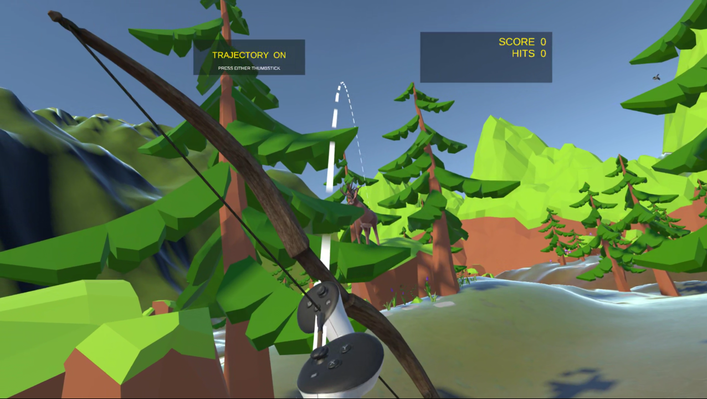
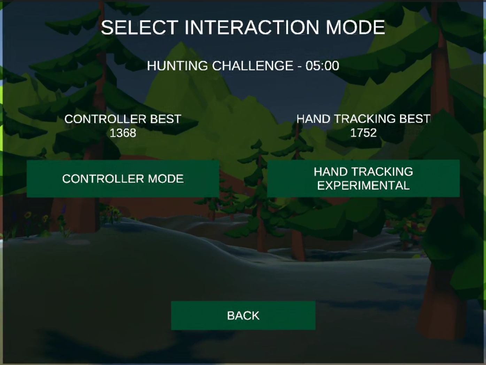
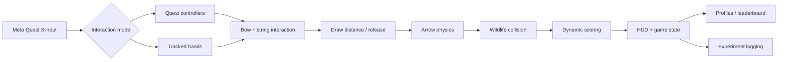
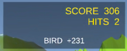
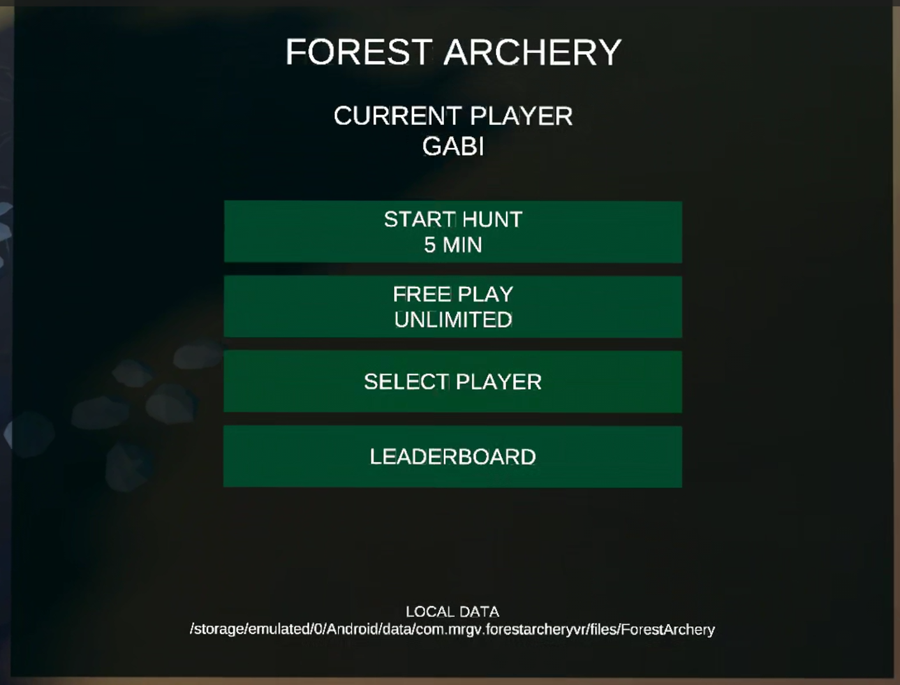
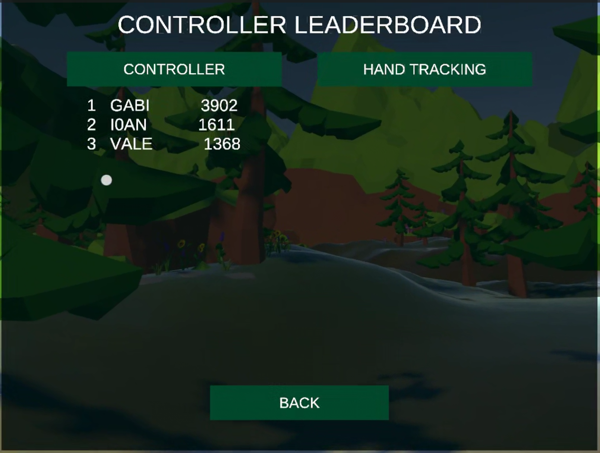
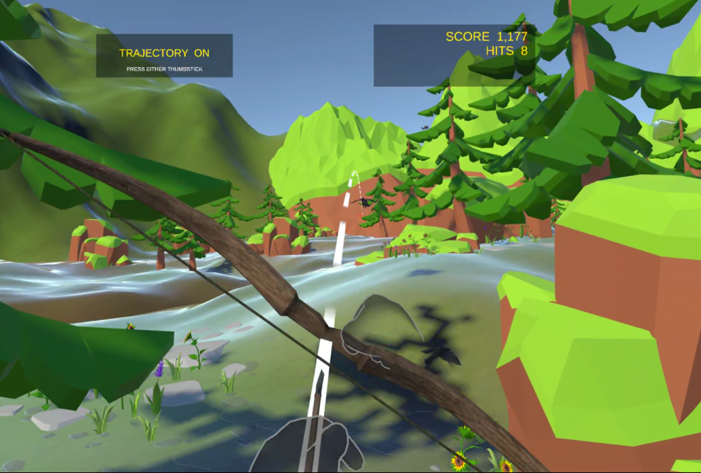

# Forest Archery VR

> **A Meta Quest 3 archery experience exploring the trade-off between reliable controller input and direct hand-tracking interaction.**

<p align="center">
  
</p>

**Unity · C# · Meta Quest 3 · Meta XR · OpenXR · Hand Tracking · VR Interaction · User Evaluation**

Forest Archery VR is a team-developed virtual-reality archery game set in a low-poly forest. The player can shoot with either **Meta Quest controllers** or **direct hand tracking**, using the same bow-and-arrow gameplay, targets, scoring rules, trajectory assistance, and game flow in both conditions.

The project goes beyond a shooting demo: it includes moving wildlife, physical arrow behaviour, dynamic scoring, player profiles, timed and unlimited game modes, local leaderboards, persistent records, experiment logging, and a structured comparison of the two interaction methods.

---

## Core experience

- **Two shooting modes:** controller-based archery and direct hand tracking.
- **Two-handed bow interaction:** hold the bow, acquire the string, draw, aim, and release.
- **Draw-dependent launch force** and Unity Rigidbody-based arrow motion.
- **Predicted trajectory** with collision-aware visual assistance.
- **Moving wildlife targets:** deer, rabbits, and birds.
- **Hit zones and dynamic scoring** based on target type, hit zone, distance, and movement.
- **Timed Hunt** and **Unlimited Free Play**.
- **Local player profiles** created directly in VR.
- **Separate controller / hand-tracking leaderboards**.
- **Persistent local results** and research-oriented logging.

<p align="center">
  
</p>

---

## Interaction architecture



The two interaction modes deliberately reuse the same gameplay systems. This makes the input method the main variable when comparing controller reliability with the naturalness of direct hand interaction.

---

## Gameplay systems

### Dynamic scoring

A successful wildlife hit is scored using:

**Final score = base score × hit-zone multiplier × distance multiplier × movement multiplier**

This rewards harder shots rather than treating every hit equally. The system also prevents one arrow from registering duplicate score events.

<p align="center">
  
</p>

### Profiles, game flow, and local records

The final game includes a complete player-facing flow rather than only a gameplay scene.

<p align="center">
  
  &nbsp;&nbsp;
  
</p>

Players can create/select local profiles, start a five-minute hunting challenge or unlimited free play, and keep controller and hand-tracking records separate.

---

## Controller vs hand tracking

The main design question was:

> **Can direct hand tracking make VR archery feel more natural without losing too much precision and reliability?**

Controller Mode provided a stable baseline with physical grip input and more consistent tracking. Hand Tracking Mode replaced the physical devices with direct tracked-hand interaction, using grab/pinch behaviour for bow and string acquisition.

<p align="center">
  
</p>

Hand tracking was intentionally treated as an **experimental interaction mode**. The main limitation was not missing gameplay functionality, but optical tracking reliability during the full-draw pose: the pulling hand can move close to the face, leave the camera's optimal field of view, or overlap the bow hand.

---

## User evaluation

A **within-subject study with six participants** compared Controller Mode and Hand Tracking Mode. Each participant tested both conditions in counterbalanced order, with practice followed by a five-minute recorded round.

The evaluation combined gameplay metrics with questionnaire ratings and observed interaction failures.

| Measure | Controller | Hand tracking |
| --- | ---: | ---: |
| Mean final score | **2091** | 1847 |
| Mean accuracy | **29.83%** | 23.26% |
| Mean successful hits | **11.33** | 9.50 |
| Immersion (1–7) | 5.17 | **6.83** |
| Naturalness (1–7) | 5.67 | **6.00** |
| Precision & control (1–7) | **5.61** | 4.28 |
| Comfort (1–7) | **6.00** | 5.00 |

In this exploratory sample, the accuracy difference was statistically significant (**p = .016**), while the final-score difference was not (**p = .159**).

The clearest engineering result was the trade-off:

- **Controllers:** more accurate, more reliable, easier to trust.
- **Hand tracking:** more immersive and slightly more natural, but more sensitive to occlusion and unstable string acquisition.

Observed interaction failures across recorded rounds were **7 for Controller Mode** and **56 for Hand Tracking Mode**, with hand tracking particularly affected by failed string grabs, interrupted draws, early releases, and tracking loss.

Because the sample was small, these results are presented as an exploratory comparison rather than a broad claim about all VR users.

---

## My contributions

This was a two-person team project. My documented contributions focused on:

- **scoring configuration** and dynamic score feedback;
- **wildlife-hit integration** with the game/scoring systems;
- the **HUD and menu flow**;
- **local player profiles and leaderboards**;
- **experiment planning**;
- **logging infrastructure**;
- organising and analysing the **user evaluation**;
- headset/gameplay **testing**;
- project documentation and presentation preparation.

My teammate focused primarily on the XR setup, controller and hand-tracking bow interaction, arrow mechanics, Meta Quest integration, Android builds, headset testing, and technical debugging. Major design decisions were reviewed together.

---

## Selected public source

This repository intentionally contains **only a curated subset of project-authored C# code** related to my contribution areas.

```text
src/
├── Scoring/
├── Profiles/
├── UI/
└── Evaluation/
```

Examples include:

- dynamic wildlife score calculation and HUD updates;
- local JSON profile persistence and leaderboard generation;
- menu/game-flow logic;
- CSV-oriented experiment logging and shot data.

The full Unity development repository remains private. This public version is intended for **technical review and portfolio presentation**, not as a standalone build.

See [SOURCE_SCOPE.md](SOURCE_SCOPE.md) for details.

---

## Tech stack

| Area | Technology |
| --- | --- |
| Engine | Unity 6000.3.6f1 |
| Language | C# |
| Headset | Meta Quest 3 |
| XR stack | Meta XR SDK, OpenXR, XR Interaction Toolkit |
| Navigation | Unity AI Navigation / NavMesh |
| Rendering | Universal Render Pipeline |
| Data | Local JSON persistence, CSV experiment logs |
| Evaluation | Within-subject user study, objective + subjective metrics |

More exact package versions are listed in [docs/PROJECT_ENVIRONMENT.md](docs/PROJECT_ENVIRONMENT.md).

---

## Public repository scope

The complete game uses third-party 3D models, vegetation, animation, audio, weapon, and wildlife assets. Their raw files are **not redistributed** in this public repository.

The screenshots above show the assembled application, while `src/` contains only selected project-authored C# files.

See [THIRD_PARTY_ASSETS.md](THIRD_PARTY_ASSETS.md).

---

## Project background

Developed as a **Virtual Reality course project** in the *Master in Robotics, Graphics and Computer Vision* at the **Universidad de Zaragoza (2025–2026)**.

The project was designed not only to create a playable VR archery experience, but also to investigate how interaction modality affects **precision, reliability, naturalness, comfort, and immersion**.

---

## Author

**Valentina Indrei**

Team project with **Ioan Spiridon**.
